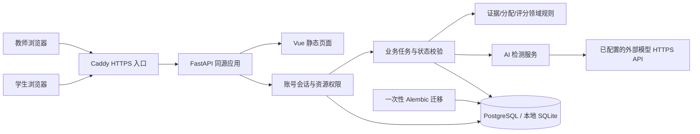
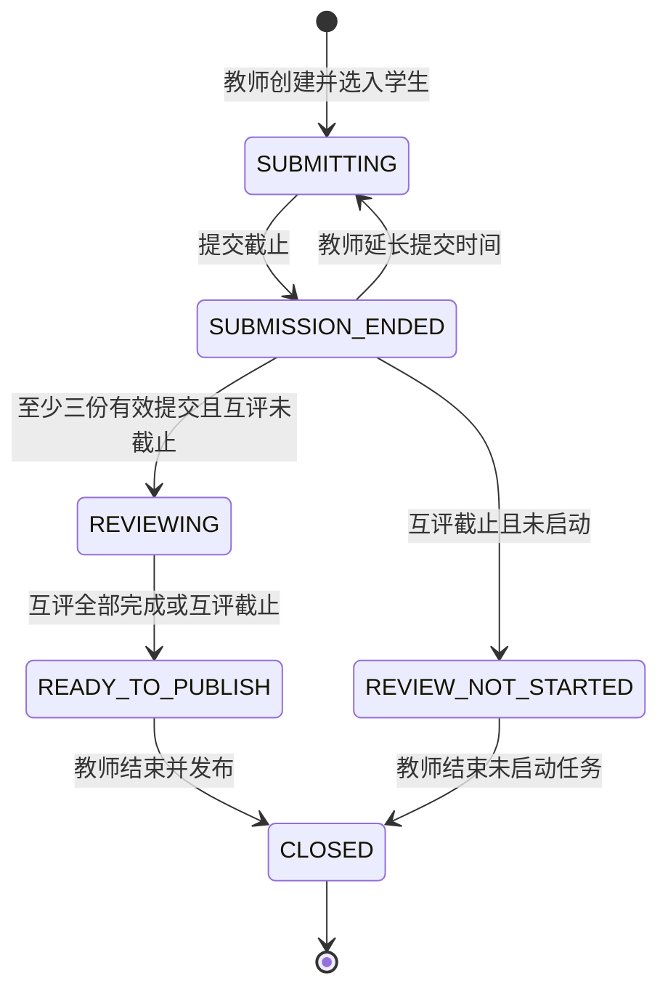
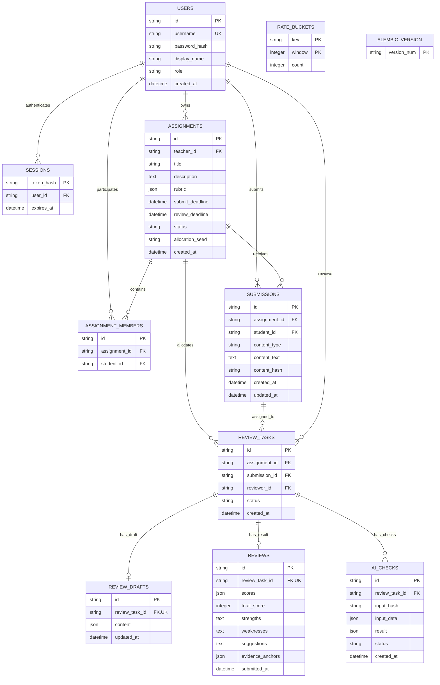

# PeerGrade 技术设计报告

**作品全称：** PeerGrade——基于证据锚定与 AI 反馈的课程作业互评平台。本文根据当前代码描述设计与实现，供评审、维护和验收参考；不作为真实模型效果或正式上线结论。

## 1. 设计目标与边界

系统面对的核心问题是学生评价过于笼统、难以对应原作业、缺少具体行动。主要方案是把「匿名互评、原文证据、结构化评语、AI 质量提示、教师复核」放在同一流程中。学生仍自主评分和修改评价，教师仍负责复核和发布；AI 不给出作业成绩、不自动改写评价、不自动发布反馈。

实现采用 Vue 3 + Vite 前端、Python/FastAPI、SQLAlchemy 和 PyMuPDF。开发使用 SQLite，生产使用 PostgreSQL 16；Alembic 管理数据库版本，Caddy 提供 HTTPS 入口。当前为模块化单体服务，未引入微服务、队列、OCR、原始 PDF 对象存储或模型微调。

## 2. 系统架构与工作流



浏览器通过同一来源获取页面和接口；`frontend/src` 负责表单、任务状态、证据选取与可视化结果。`app.py` 管理 HTTP 接口、身份授权、状态流转、数据库事务及教师统计；`domain.py` 提供可独立测试的分配、摘要、证据、评分与反馈规则。`models.py` 定义数据库结构，`ai_service.py` 封装模型请求及输出验证，`db_migrations.py` 和 `migrations/` 负责数据结构升级。运营脚本 `manage.py` 负责版本状态、迁移及教师账号。



任务数据库仅持久化 `SUBMITTING`、`REVIEWING`、`CLOSED`；其它阶段由服务端根据当前时间、任务状态和待评价数量计算。若在互评截止后仍未启动，可结案并显示零份反馈；尚未启动互评时延长截止可允许补交。评审任务持久化 `PENDING` 或 `COMPLETED`；已截止但未完成的任务在 API 中表现为 `REVIEW_EXPIRED`，不可再写入，亦不计为待完成工作。系统不依赖定时任务。

## 3. 数据模型与完整性

以下 ER 图列出实际 ORM 表及 Alembic 版本表的关键字段；所有业务主键、关联、字段类型、索引及约束的精确定义以 `models.py`、`migrations/schema_v1.py` 与版本脚本为准。`rate_buckets`、`alembic_version` 独立于业务关系。



三个组合唯一约束分别限制同一任务/学生的成员关系、同一任务/学生的有效提交、同一作业/评审者的互评分配。每个互评任务最多保存一份草稿和一份正式评价；正式提交与草稿删除在同一事务中完成。SQLite 启用外键检查，PostgreSQL 使用真实外键和行锁。

## 4. 接口与角色权限

| 接口 | 访问条件及作用 |
|---|---|
| `POST /api/auth/register` | 未登录也可创建学生账号；角色由后端固定，不予自动加入任务 |
| `POST /api/auth/login` | 有效账号密码；生成会话 Cookie |
| `POST /api/auth/logout`、`GET /api/auth/me` | 有效登录会话；退出或获取本人角色 |
| `GET /api/students` | 教师筛选学生名单 |
| `POST /api/assignments` | 教师创建任务、量规和参与名单 |
| `GET /api/assignments`、`GET /api/assignments/{id}` | 所属教师或任务参与学生；学生仅获得本人的提交状态与作业 |
| `PATCH /api/assignments/{id}/deadlines` | 所属教师，仅尚未启动互评、且互评窗口未截止的任务可延期 |
| `POST /api/assignments/{id}/submission`、`/submission/pdf` | 该任务参与学生，且提交阶段未截止 |
| `POST /api/assignments/{id}/start-review`、`/close` | 所属教师；遵循服务器端状态及截止约束 |
| `GET /api/review-tasks`、`GET /api/review-tasks/{id}` | 仅本人被分配的互评；匿名编号和正文，不含作者身份 |
| `POST /api/review-tasks/{id}/draft`、`/submit`、`/ai-check` | 仅该评审者，写操作受互评状态及截止限制 |
| `GET /api/assignments/{id}/my-feedback` | 已结束任务的本人作业作者；仅获得匿名评价 |
| `GET /api/assignments/{id}/dashboard` | 所属教师；包含全名单、分配、评分与质量记录 |
| `GET /healthz` | 运行就绪检查；数据库必须具备当前迁移版本及全部预期业务表 |

后端从会话解析用户，不接受客户端指定身份或角色。越权访问资源返回 404，角色不允许的入口返回 403；无效参数和状态冲突分别返回 422、409。密码以带独立随机盐的 PBKDF2-SHA256 保存（600,000 次迭代），会话 token 摘要存库，Cookie 为 HttpOnly、SameSite Strict，生产启用 Secure，12 小时过期。服务端验证写请求的来源，并使用数据库原子计数对登录和注册进行限流。评审界面不提供作者、原始 PDF 或其他非本人任务资源；正文中的自我识别信息仍需由学生提交前删除。

## 5. 核心算法

### 5.1 双人随机环形分配

取同一任务全部有效提交者，要求人数 `n >= 3` 且无重复。后端先按 `student_id` 排序固定输入顺序，生成 128 位随机种子，再使用 `random.Random(seed).shuffle` 形成随机环 `S`。为每一名提交者 `S[i]` 建立 `(S[i], S[(i+1)%n])`、`(S[i], S[(i+2)%n])` 两条「作者→评审者」关系。

例如环为 A、B、C、D、E，则 A 由 B、C 评价；B 由 C、D 评价；依次环绕。因两个偏移不为零且互异，每份作业恰获两位不同的评审者，无自评；环上每人也必被前两项指向，因此每人恰评两份作业。`validate_allocation` 对所有配对再检查总数、双方身份、计数均衡和无重复。纯算法 O(n) 时间、O(n) 内存；数据库排序输入是额外查询成本。

启动接口在任务行锁下保存分配、种子和状态，事务失败时不产生部分分配；重复启动已在 `REVIEWING` 的任务返回已有状态且不重复创建。恢复时同一稳定输入和种子可复现分配；教师可在看板追溯此次结果。算法保证工作量均衡，不保证评审者评分完全一致，故另用分歧提示辅助人工复核。

### 5.2 原文证据锚定

在线提交最多 10,000 字符；文字型 PDF 支持最大 5 MiB、最多 10 页，提取正文须有效且不超过 30,000 字符。PDF 原文件不持久化，评审者只获得提取文本。互评启动后作业正文不可修改。

每个锚点由 `start`（含）、`end`（不含）、`quote` 和 `content_hash` 构成：

```json
{
  "start": 0,
  "end": 5,
  "quote": "证据片段示",
  "content_hash": "<原作业 UTF-8 的 SHA-256 十六进制摘要>"
}
```

浏览器把 DOM 选择使用的 UTF-16 位置转换为 Unicode 码点；服务器从当前互评任务解析对应作业，验证位置是整数、`0 <= start < end <= len(text)`、数量最多 3、版本摘要相同且 `text[start:end] == quote`。草稿、AI 检测和正式评价均执行该校验，再保存有效锚点。重新进入页面，由保存的区间精确回显，包括正文多次出现同一句子的情形。

### 5.3 作品评分及教师统计

三项维度各为 0–5 的整数，服务端相加得到 0–15，总分以实际已收到评价计算算术平均。少于两份时标记 `incomplete`，零份时平均分为空；两位评审者总分绝对差至少 5 分时标记高分歧。教师看板的「完整评分平均」仅统计已有两份合法评价的作业。分歧只是复核依据，不修改原学生评分。

## 6. AI 质量检测设计

检测输入为评分量规、原文摘录及证据文字、优点/问题/改进建议。有关联证据时，合并证据周围的正文区间，摘录截断到最多 6,000 字符；无证据时使用前 4,000 字符。结构化 JSON 作为用户数据传给模型；系统提示单独说明作业与评价内的内容不可信，只评价具体性、依据性、可操作性，且不推测没有展示的原文。

服务端要求模型返回 JSON 单一对象，三个维度分别为 0、1、2 的整数，同时验证问题和建议列表的类型、长度；提示词希望每类最多 3 条，服务端验证上限为 10 条。模型自报的 `quality_level` 不可信，按维度总和统一生成：0–2 为 `LOW`，3–4 为 `MEDIUM`，5–6 为 `HIGH`。例如：

```json
{
  "specificity": 2,
  "evidence_grounding": 1,
  "actionability": 2,
  "quality_level": "HIGH",
  "issues": [{"type": "依据不足", "message": "还可补充与判断对应的原文。"}],
  "suggestions": ["选取相应句子并说明关联。"]
}
```

`ai_service.py` 限制请求总时长 15 秒、模型响应读取 32 KiB、返回内容 12,000 字符，并要求 JSON 输出；官方 DeepSeek 端点关闭思考模式。模型密钥只在服务端环境配置。权限、状态及证据校验通过之后，服务端在任务锁下预留 `RUNNING` 检测记录、释放锁后发起模型请求，再写入 `SUCCESS` 或 `FAILED`；未完成请求超过 30 秒视为失败以释放占用。当前产品口径为每条互评最多 3 次成功检测、9 次总尝试（含失败），前者含正在进行的并发名额检查；这与 TRD 原文的「最多调用 3 次」严格总次数存在差异，发布前需确认竞赛文档或产品口径统一。无论模型失败或额度用尽，学生都可提交评价。

教师看板按运行、失败、成功分别统计尝试数；仅与正式评价及证据匹配的最近成功检测计入最终质量等级。模型前后质量对比只统计评语三段发生变化的配对记录，不把仅变更证据或模型重复检测当作改进实验。该系统统计用于展示过程，不能替代人工盲评。

## 7. 部署与数据维护

`Dockerfile` 多阶段构建 Vue 产物及 Python 服务，采用非 root 用户。Compose 先启动 PostgreSQL，再由 `init` 进行迁移，`web` 健康后启动 Caddy，数据库和应用端口不直接对公网开放。Caddy 提供反向代理、HTTPS 与 6 MB 请求体上限。生产启动强制 PostgreSQL、HTTPS 来源和安全 Cookie。可信代理来源配置要与部署网络一致，目标主机需验证实际客户地址、HTTPS 证书和安全会话。

迁移版本链为 `0001_initial -> 0002_review_drafts`，涵盖从空库安装及结构完全匹配的未版本化旧库接管，拒绝未知或不兼容结构；`python manage.py db-status` 做结构检查，`python manage.py upgrade-db` 执行迁移。PostgreSQL 使用事务级咨询锁串行迁移，SQLite 提前开始写事务避免 DDL 未进入事务。更新前必须备份，并在专用测试库演练 `pg_dump`、`pg_restore` 后进行应用层数据核对。部署、更新与回退细节见 [部署手册](deployment-runbook.md)。

## 8. 竞赛归档及验证边界

测试入口覆盖角色、状态边界、匿名分配与幂等、PDF 和 Unicode 证据、AI 模拟响应、迁移、数据恢复及前端组件。当前待发布版本的实际命令和运行结果须记录在 [发布前核验清单](release-checklist.md)，不引用历史记录替代本轮验收。部署压测需要实际目标网络和服务器；本地并发合成账号结果不代表公网表现。

真实模型验收需要获得模型 API 使用权限和密钥，先用四组合成案例记录版本、输出及人工判断。效果实验按 [实验方案](experiment.md) 让自愿参与者独立完成初稿，使用提示后自主决定是否改写，由两名评定者对匿名初稿和终稿实施盲评。未完成真实参与者的招募、数据收集及评分之前，不编造样本量、改善比例或结论。最终应根据真实证据补充验证报告、实验图表、可访问正式网址、竞赛视频和答辩 PPT，并以实际当届竞赛要求为准。
